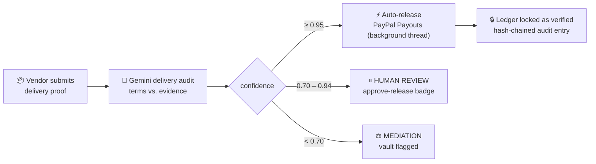
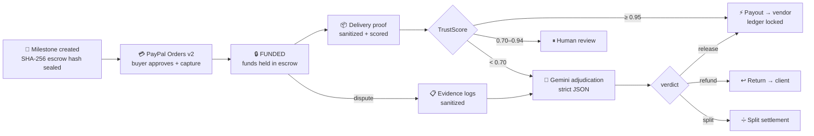

<div align="center">

# ⚡ TrustLedger AI

### *Autonomous Vendor Escrow & Dispute Mediator*

**Money sits in escrow. AI settles the fight. Nobody waits 14 business days.**


`◆ SECURITY-HARDENED` · `◆ TRUSTSCORE AUTO-RELEASE` · `◆ ZERO BUILD STEP` · `◆ 44 TESTS GREEN`

</div>

---

## 🎯 The Pitch

> **Freelancers and micro-merchants lose billions every year to payment disputes that take weeks to resolve.** Traditional escrow is slow, human-mediated, and expensive. TrustLedger AI collapses that pipeline into **one autonomous loop**.

| The Old World 😩 | The TrustLedger Way ⚡ |
|---|---|
| Escrow released after manual review cycles | **TrustScore AI auto-releases** at ≥ 0.95 confidence — funds move in the same request |
| Dispute evidence scattered across emails & chats | **Evidence logs** sanitized, persisted, timestamped, attached to the vault |
| Terms changed mid-project with no trace | **SHA-256 agreement hashing** — tamper-evident by construction |
| Payment rails bolted on as an afterthought | **PayPal REST v2 Orders + Payouts** native — fund, capture, release in one flow |

**The loop is fully autonomous:** client funds a milestone → vendor submits delivery proof → Gemini scores it against the agreed terms → **≥ 0.95 releases escrow instantly via PayPal Payouts**, 0.70–0.94 holds for one-click human review, below 0.70 escalates to mediation.

---

## 🧠 TrustScore AI — Dynamic Escrow Auto-Release

The unique capability, wired directly into the existing escrow model (no new UI surface, one extra column + one modal):



| Band | Action | What the operator sees |
|---|---|---|
| **≥ 0.95** | Instant payout through `v1/payments/payouts` on a daemon thread; `DeliveryProof.auto_released = true`; `Milestone.ledger_verified = true` | `AUTO-RELEASE` badge + lock icon on the ledger row |
| **0.70 – 0.94** | No money moves; vault held at `work_submitted` with `recommendation = human_review` | `REVIEW` badge + **Approve release** button |
| **< 0.70** | Vault moves to `disputed` with `recommendation = mediation` | `MEDIATE` badge, dispute evidence form |

Guarantees that make it safe to automate money:

- **Tamper check before payout** — `settle_release()` re-verifies the SHA-256 escrow hash; a mismatch blocks the release and logs `release_blocked:hash_mismatch`.
- **Idempotent settlement** — an already-settled vault can never pay twice (guarded by status + audit chain).
- **Hash-chained audit trail** — every settlement appends `sha256(previous_hash | entry)` to `Milestone.audit_hash`; rewriting history breaks the chain.
- **Honest demo mode** — without PayPal credentials the payout is recorded as `SIMULATED`, never as a completed transfer. The dashboard counter only counts real auto-releases.
- **Only `release` verdicts auto-pay.** A high-confidence `refund`/`split` always reaches a human.

---

## 🔒 Security & Compliance

| Threat vector | Mitigation |
|---|---|
| 🔑 **API key leaks** | Every credential (`PAYPAL_CLIENT_ID`, `PAYPAL_CLIENT_SECRET`, `GEMINI_API_KEY`, `SECRET_KEY`) loads via `python-dotenv` from `.env` **only** — zero hardcoded fallbacks; `DEBUG=0` refuses to boot without a real `SECRET_KEY`; `.env` is git-ignored and `.env.example` is the only tracked template |
| 🧨 **XSS in evidence / descriptions** | `trustledger/security.py`: stdlib HTML parser strips **every** tag (allowlist = none) and drops `<script>`/`<style>` bodies, removes C0 controls + bidi/zero-width characters, caps length. Applied to milestone titles, descriptions, party refs, dispute evidence and delivery artifacts **before** storage or AI consumption. Templates run Django autoescape; inline JS args use `\|escapejs` |
| 🧾 **Prompt override / markdown injection** | User text is fenced as `<<<UNTRUSTED_DATA:…>>>` and declared data-only in the system prompt; triple-backticks are neutralized. The verdict is constrained by `responseSchema` **and** a strict key/type/enum whitelist at parse time — extra keys, wrong types, unknown decisions and non-object payloads raise instead of settling |
| 🌐 **CSRF / method abuse** | `CsrfViewMiddleware` globally; **escrow funding, milestone creation, delivery proof, human release and dispute submission are POST-only** (`@require_POST`); `fetch()` sends `X-CSRFToken`. Capture (PayPal's GET return URL) requires a `?token=` that matches the stored order — a forged link can't force a capture |
| ☠️ **EOL runtime risks** | Python 3.12+ / Django 5.2, pure-Python stack, no Node build pipeline |
| 🕵️ **Model output trust** | LLM verdicts are schema-whitelisted, enum-checked, confidence-clamped to `[0,1]`, reasoning length-capped and re-sanitized. Raw model text is never rendered |
| 💸 **Ratio/rounding bugs** | Money is `Decimal` everywhere (`DecimalField(10,2)`, `Decimal` parsing, `quantize`), never float |

---

## 🏗 System Architecture



**Stack:** Django 5 function-based views · SQLite (zero-config) · Tailwind CSS v3 via CDN (zero build) · `fetch()` + CSRF live verdict modals · `requests` wrappers for PayPal and Gemini.

---

## ⚡ Quickstart

```bash
git clone https://github.com/saviochackoxavier-tech/trustledger-ai.git
cd trustledger-ai

python -m venv venv
source venv/bin/activate          # Windows: venv\Scripts\activate
pip install -r requirements.txt

cp .env.example .env              # then paste YOUR sandbox keys
#   PAYPAL_CLIENT_ID / PAYPAL_CLIENT_SECRET  → developer.paypal.com (Sandbox)
#   GEMINI_API_KEY                          → aistudio.google.com/apikey
#   SECRET_KEY                              → any random 64-char string

python manage.py migrate
python manage.py seed_demo        # 5 showcase vaults (incl. a 0.97 auto-release)
python manage.py runserver        # → http://127.0.0.1:8000 🎉
```

**Demo path:** dashboard (funded vault + AI verdict) → **Fund** the awaiting vault (live PayPal Sandbox approval → auto-capture) → **Deliver** on a funded vault → watch TrustScore route the vault (auto-release / review badge / mediation).

> `seed_demo` is idempotent; `python manage.py seed_demo --reset` rebuilds the demo set.

---

## 🧪 Proof of Work

```bash
python manage.py check                  # System check identified no issues
python manage.py test trustledger -v 2  # Ran 44 tests ... OK
```

| Area | Verified |
|---|---|
| Sanitization | `<script>`/`` stripped, bidi & zero-width removed, length caps, ref whitelist, fenced prompt data |
| CSRF | POST without token → 403 (enforced with `Client(enforce_csrf_checks=True)`) |
| HTTP method discipline | `GET /milestones/new/`, `GET /pay/<id>/`, `GET /deliver/<id>/` → 405 |
| Escrow integrity | Hash sealed once, never re-sealed, tamper → release blocked 409 + audit entry |
| Funding | No credentials → fails closed 502, vault untouched; double-fund → 409; bad capture token → guard page, no capture |
| TrustScore routing | 0.97/0.95 → auto-release, 0.82 → human review, 0.69 → mediation; non-release verdicts never auto-pay |
| Auto-release settlement | Payout transaction created, `ledger_verified` set, audit hash written, proof flagged; real API path sets `COMPLETED`, missing creds sets `SIMULATED` |
| Idempotency | Second release attempt → 409, still exactly one payout |
| Gemini contract | Markdown fences tolerated; extra keys, unknown enums, string confidence, arrays rejected; confidence clamped |
| Dispute flow | Verdict settles vault (`refund` → refunded), short evidence 400, settled vault 409, evidence sanitized |
| Seeder | 5 vaults, 1 auto-release, 1 review hold, simulated payout, idempotent re-run |
| Pages | Dashboard renders metrics + TrustScore column without error |

**Real-HTTP smoke test** (`scripts/smoke_http.py`) drives a live server: CSRF cookie issued, token-less POST 403, XSS payload not stored raw, GET-fund 405, unfunded delivery 409, short evidence 400, forged capture token refused, delivery route wired.

---

## 📁 Project Layout

```text
trustledger-ai/
├── manage.py
├── requirements.txt
├── .env.example                 # tracked template — real .env is git-ignored
├── config/
│   ├── settings.py              # env-only secrets, CSRF, prod hardening, TrustScore env
│   └── urls.py
├── trustledger/
│   ├── models.py                # Milestone · Transaction · DeliveryProof · DisputeEvidence
│   ├── security.py              # strict sanitizers (HTML/JS/bidi/control)
│   ├── trustscore.py            # thresholds, routing, settlement, audit chain
│   ├── ai_agent.py              # Gemini arbitration + delivery audit, strict JSON
│   ├── paypal.py                # Orders v2 + Payouts v1 (env-only creds)
│   ├── views.py                 # dashboard · create · fund · capture · deliver · release · dispute
│   ├── tests.py                 # 44 regression tests
│   ├── management/commands/seed_demo.py
│   ├── migrations/              # 0001 → 0003
│   └── templates/trustledger/
│       ├── dashboard.html       # Tailwind bento grid + TrustScore column/modals
│       └── capture.html         # forged-capture-token guard page
└── scripts/
    └── smoke_http.py            # live-HTTP security smoke test
```

---

## 🔌 Endpoints

| Method | Path | Purpose |
|---|---|---|
| GET | `/` | Dashboard: KPIs (incl. auto-released), vaults, TrustScore badges, AI verdict |
| POST | `/milestones/new/` | Create + sanitize milestone, seal SHA-256 escrow hash |
| POST | `/pay/<uuid>/` | Create PayPal order → redirect to approval |
| GET | `/pay/<uuid>/capture/?token=` | PayPal return URL; token verified before capture |
| POST | `/deliver/<uuid>/` | **TrustScore AI**: score proof → auto-release / review / mediation |
| POST | `/release/<uuid>/` | Human approval for the 0.70–0.94 band |
| POST | `/dispute/<uuid>/` | Gemini arbitration → release / refund / split |

---

## ⚙️ Configuration

| Variable | Default | Notes |
|---|---|---|
| `SECRET_KEY` | ephemeral in DEBUG | Required (non-placeholder) when `DEBUG=0` |
| `DEBUG` | `1` | `0` enables SSL redirect, HSTS, secure cookies, nosniff |
| `ALLOWED_HOSTS` | `127.0.0.1,localhost` | Comma-separated |
| `CSRF_TRUSTED_ORIGINS` | localhost:8000 | Comma-separated |
| `PAYPAL_CLIENT_ID` / `PAYPAL_CLIENT_SECRET` | — | Sandbox app credentials; absent → payout recorded `SIMULATED` |
| `PAYPAL_API_BASE` | `https://api-m.sandbox.paypal.com` | Must be `https://` |
| `SITE_BASE_URL` | `http://127.0.0.1:8000` | PayPal return/cancel URLs |
| `GEMINI_API_KEY` | — | Absent → TrustScore/dispute return 502, never a guess |
| `GEMINI_MODEL` | `gemini-2.0-flash` | Any JSON-capable Gemini model |
| `TRUSTSCORE_AUTO_RELEASE` | `0.95` | Auto-payout cut-off |
| `TRUSTSCORE_REVIEW` | `0.70` | Human-review cut-off (forced below auto-release) |
| `TRUSTLEDGER_RELEASE_ASYNC` | `1` | `1` = payout on a daemon thread |

---

## 🚢 Production checklist

- `DEBUG=0`, real `SECRET_KEY`, explicit `ALLOWED_HOSTS`, HTTPS.
- PostgreSQL for concurrent writes; keep the escrow-hash and payout indices.
- Queue the payout on Celery/RQ instead of an in-process thread, with retries.
- Add operator authentication in front of `/release/` and `/dispute/` (the demo has no auth model by design).
- Persist audit entries to append-only storage/WORM for regulated escrow.
- Review PayPal Payouts eligibility rules and Gemini data-retention settings.

---

<div align="center">

**Built for the PayPal AI Hackathon 2026.**

*TrustLedger AI — because "we'll get back to you in 5–7 business days" is not dispute resolution.*

</div>
