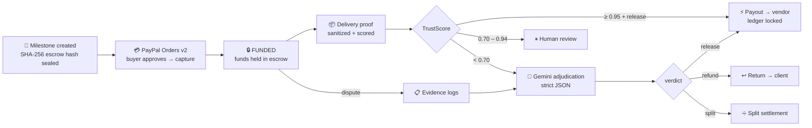

<div align="center">

# ⚡ TrustLedger AI

### *Autonomous Vendor Escrow & Dispute Mediator*

**Money sits in escrow. AI settles the fight. Nobody waits 14 business days.**

[](https://www.python.org/)
[](https://www.djangoproject.com/)
[](https://tailwindcss.com/)
[](https://developer.paypal.com/)
[](https://ai.google.dev/)
[](LICENSE)

[](#-testing--proof-of-work)
[](#-security-model)
[](#-architecture)
[](#-quickstart)

[**▶ Watch the demo**](#-demo) · [How it works](#-the-autonomous-loop) · [TrustScore AI](#-trustscore-ai--dynamic-escrow-release) · [Security](#-security-model) · [Legal](#-legal--compliance) · [Quickstart](#-quickstart)

</div>

---

## ▶️ Demo

<div align="center">

### [](https://drive.google.com/file/d/1WX02gTDRmYPjeJhw7Z2JN9JA2vPHXjDf/view?usp=sharing)

**[TrustLedger AI Demo Video →](https://drive.google.com/file/d/1WX02gTDRmYPjeJhw7Z2JN9JA2vPHXjDf/view?usp=sharing)**

*Fund a milestone → vendor submits delivery proof → TrustScore AI releases escrow at ≥ 0.95 → a contested milestone goes to Gemini arbitration.*

</div>

---

## 🎯 The Pitch

> Freelancers and micro-merchants lose billions every year to payment disputes that take weeks to resolve. Traditional escrow is slow, human-mediated, and opaque. Marketplaces hold funds hostage with no explainable timeline.

**TrustLedger AI collapses that pipeline into one autonomous loop:** the client funds a milestone, the vendor proves delivery, and a schema-constrained Gemini verdict decides whether escrow releases, refunds, or splits — in seconds, with a tamper-evident audit trail.

| The old world 😩 | The TrustLedger way ⚡ |
|---|---|
| Escrow released after manual review cycles | **TrustScore AI auto-releases** at ≥ 0.95 confidence — the payout is dispatched in the same request |
| Evidence scattered across email, Slack and Notion | **Sanitized evidence logs** persisted, timestamped and bound to the vault |
| Terms edited mid-project with no trace | **SHA-256 escrow hash** sealed on creation; payout is refused on mismatch |
| Funds held by an opaque intermediary | **Hash-chained audit ledger** — every settlement appends to a verifiable chain |
| Payment rails bolted on as an afterthought | **PayPal REST v2 Orders + v1 Payouts** native: fund → capture → release |

---

## ✨ Feature Bento

<table>
<tr>
<td width="50%" valign="top">

### 🔐 Tamper-Evident Agreements
Every milestone seals a deterministic **SHA-256** hash over its frozen terms (`id · title · amount · currency · client · vendor`). Mutate the agreement after funding and `verify_escrow_hash()` blocks the payout — the attempt itself lands in the audit chain.

</td>
<td width="50%" valign="top">

### ⚡ TrustScore AI Auto-Release
Gemini scores vendor delivery proof against the buyer's stated terms. **≥ 0.95 → instant PayPal Payouts release** on a daemon thread. **0.70–0.94 → human review badge.** **< 0.70 → mediation.**

</td>
</tr>
<tr>
<td valign="top">

### ⚖️ Gemini Dispute Mediation
Evidence logs in, strict JSON out: `{"decision": "release|refund|split", "confidence": 0..1, "reasoning": "..."}`. Constrained by `responseSchema` **and** a runtime whitelist — malformed output fails closed instead of settling.

</td>
<td valign="top">

### 💳 Real PayPal Rails
`v1/oauth2/token` with memoized credentials → `v2/checkout/orders` → capture guarded on `COMPLETED` → `v1/payments/payouts`. No heavyweight SDK; a 200-line `requests` wrapper with token refresh on 401.

</td>
</tr>
<tr>
<td valign="top">

### 🖤 Dark Bento Dashboard
Tailwind CSS v3 via CDN — zero build step. Four KPI cards, a live vault table with TrustScore badges, an AI verdict panel with an animated confidence meter, and three focused modals.

</td>
<td valign="top">

### 🧾 Immutable Audit Chain
Each settlement appends `sha256(previous_hash | entry)` to `Milestone.audit_hash` and locks the ledger entry as **verified**. Rewriting history breaks the chain.

</td>
</tr>
</table>

---

## 🔁 The Autonomous Loop



---

## 🧠 TrustScore AI — Dynamic Escrow Release

The differentiating capability, wired directly into the existing escrow model — one extra column, one modal, no new surface area.

| Confidence | Decision | System action | Operator sees |
|---:|---|---|---|
| **≥ 0.95** | `release` | PayPal payout dispatched on a daemon thread; `DeliveryProof.auto_released = true`; ledger entry locked as verified | `AUTO-RELEASE` badge + 🔒 |
| **0.70 – 0.94** | `release` | Funds held; `recommendation = human_review` | `REVIEW` badge + **Approve release** button |
| **< 0.70** | any | Vault moves to `disputed`; `recommendation = mediation` | `MEDIATE` badge + evidence form |
| any | `refund` / `split` | **Never** auto-pays — a human always sees it | Badge + arbitration panel |

**Why it is safe to let this move money**

- **Tamper check first** — `settle_release()` re-verifies the escrow hash; mismatch → `release_blocked:hash_mismatch` in the audit chain.
- **Idempotent** — a settled vault cannot pay twice (status + chain guard).
- **Fail-closed** — a missing `GEMINI_API_KEY` returns `502`, never a guessed verdict; a PayPal failure records a `FAILED` transaction instead of claiming success.
- **Honest demo mode** — with no credentials the payout is recorded as `SIMULATED`, never as a completed transfer.
- **Explainable** — every score ships with AI reasoning and a `missing_items` list the operator can act on.

```bash
# Thresholds are configuration, not code
TRUSTSCORE_AUTO_RELEASE=0.95
TRUSTSCORE_REVIEW=0.70
TRUSTLEDGER_RELEASE_ASYNC=1
```

---

## 🏗 Architecture

**Django 5.2 function-based views · SQLite (zero-config) · Tailwind CSS v3 via CDN (zero build) · `fetch()` + CSRF modals · `requests` wrappers for PayPal and Gemini.**

```text
trustledger-ai/
├── manage.py                       # sys.path-safe entrypoint
├── requirements.txt                # Django, python-dotenv, requests
├── LICENSE                         # MIT
├── .env.example                    # tracked template — the real .env is git-ignored
├── README.md
│
├── config/
│   ├── settings.py                 # env-only secrets, CSRF, prod hardening, TrustScore env
│   ├── urls.py                     # root router + dark 403/404/500 handlers
│   └── wsgi.py
│
├── trustledger/
│   ├── models.py                   # Milestone · Transaction · DeliveryProof · DisputeEvidence
│   ├── views.py                    # dashboard · create · fund · capture · deliver · release · dispute
│   ├── urls.py                     # 7 routes, all mutations POST-only
│   ├── trustscore.py               # thresholds, routing, settlement, hash-chained audit
│   ├── ai_agent.py                 # Gemini dispute + delivery audit, strict JSON whitelist
│   ├── paypal.py                   # Orders v2 + Payouts v1, env-only credentials
│   ├── security.py                 # strict sanitizers (HTML/JS/bidi/control chars)
│   ├── tests.py                    # 47 regression tests
│   ├── management/
│   │   └── commands/seed_demo.py   # 5 showcase vaults (idempotent, --reset)
│   ├── migrations/                 # 0001 → 0003
│   └── templates/trustledger/
│       ├── dashboard.html          # dark bento grid, TrustScore column, 3 modals
│       ├── fund.html               # escrow funding page (never a blank /pay/ page)
│       ├── capture.html            # forged-capture-token guard page
│       └── error.html              # dark 400/403/404/409/500 page
│
├── legal/
│   ├── TERMS_OF_SERVICE.md         # escrow + AI mediation binding terms
│   ├── PRIVACY_POLICY.md           # processors, retention, GDPR/CCPA rights
│   ├── DATA_PROTECTION.md          # TOMs, DSR handling, breach playbooks
│   ├── AI_DATA_USAGE.md            # Gemini data scope + training/retention position
│   └── README.md                   # compliance index & pre-production obligations
│
└── scripts/
    └── smoke_http.py               # live-HTTP security smoke test
```

---

## 🔒 Security Model

| Threat vector | Mitigation |
|---|---|
| **API key leaks** | Every credential (`PAYPAL_CLIENT_ID`, `PAYPAL_CLIENT_SECRET`, `GEMINI_API_KEY`, `SECRET_KEY`) loads via `python-dotenv` from `.env` **only** — no hardcoded fallbacks. With `DEBUG=0` the app refuses to boot without a real `SECRET_KEY`. `.env` is git-ignored; `.env.example` carries placeholders. |
| **XSS in evidence / descriptions** | `security.py` strips **every** HTML tag (allowlist: none), drops `<script>`/`<style>` bodies, removes C0 controls and Unicode bidi/zero-width characters, caps length. Applied to titles, descriptions, party refs, evidence and delivery artifacts before storage or AI use. Templates auto-escape; 0 uses of `\|safe`. |
| **Prompt override / markdown injection** | User text is fenced as `<<<UNTRUSTED_DATA:…>>>` and declared data-only in the system prompt; triple backticks neutralized. Verdicts are constrained by `responseSchema` **and** a runtime key/type/enum whitelist — extra keys, unknown decisions, string confidences and arrays raise instead of settling. |
| **CSRF / method abuse** | `CsrfViewMiddleware` global. Milestone creation, funding, delivery proof, human release and dispute submission are `@require_POST`. PayPal's GET return URL must carry a `?token=` matching the stored order, so a forged link cannot force a capture. |
| **Double spend** | Settlement is idempotent: a settled vault returns `409` and never pays twice. |
| **Rounding errors** | Money is `Decimal` end-to-end (`DecimalField(10,2)`, `quantize`) — never float. |
| **Blank / broken pages** | Browser navigations that hit a refusal render the dark `error.html` or `fund.html`; AJAX callers still receive structured JSON. `handler403/404/500` are registered for production. |
| **Missing credentials** | Graceful, explicit fallbacks: no `GEMINI_API_KEY` → `502` "AI mediator unavailable"; no PayPal keys → `502` "PayPal is unavailable"; payouts recorded as `SIMULATED`. **No route 500s on missing configuration.** |

```console
$ python manage.py check --deploy          # DEBUG=0 production profile
System check identified no issues (0 silenced).
```

---

## 📜 Legal & Compliance

Enterprise-readiness documents ship in [`legal/`](legal/README.md):

| Document | What it establishes |
|---|---|
| [**Terms of Service**](legal/TERMS_OF_SERVICE.md) | Governing terms for automated escrow settlement and AI mediation — including express consent that a ≥ 0.95 TrustScore release is an automated contractual act, and a 14-day human-review right over any verdict |
| [**Privacy Policy**](legal/PRIVACY_POLICY.md) | Data categories, purposes and legal bases, processors (PayPal, Google), retention schedule, GDPR/CCPA data-subject rights |
| [**Data Protection**](legal/DATA_PROTECTION.md) | GDPR/CCPA-aligned technical & organizational measures for financial transaction logs: classification, secret isolation, hash chains, DSR handling, breach playbooks |
| [**AI Data Usage**](legal/AI_DATA_USAGE.md) | Exactly what is sent to Google Gemini, injection containment, model-training/retention position, human-oversight guarantees |

> **Honest scope.** This is a hackathon reference implementation running on PayPal Sandbox — not a licensed escrow agent, money transmitter, or law firm. The policies are production-shaped templates; counsel review, contact-address replacement, regulator registration and Gemini tier confirmation are required before deployment. See [`legal/README.md`](legal/README.md) for the full checklist.

---

## ⚡ Quickstart

```bash
git clone https://github.com/saviochackoxavier-tech/TrustLedger-AI.git
cd TrustLedger-AI

python -m venv venv
source venv/bin/activate          # Windows: venv\Scripts\activate
pip install -r requirements.txt

cp .env.example .env              # then paste YOUR sandbox keys
```

```env
# .env — never commit this file
PAYPAL_CLIENT_ID=...
PAYPAL_CLIENT_SECRET=...
PAYPAL_API_BASE=https://api-m.sandbox.paypal.com
SITE_BASE_URL=http://127.0.0.1:8000

GEMINI_API_KEY=...
GEMINI_MODEL=gemini-2.0-flash

SECRET_KEY=generate-a-random-64-char-string
DEBUG=1
ALLOWED_HOSTS=127.0.0.1,localhost
```

```bash
python manage.py migrate
python manage.py seed_demo        # 5 showcase vaults, incl. a 0.97 auto-release
python manage.py runserver        # → http://127.0.0.1:8000 🎉
```

**Demo path:** dashboard → **Fund** the awaiting vault (PayPal Sandbox approval → auto-capture) → **Deliver** on a funded vault → watch TrustScore route it (auto-release / review badge / mediation) → or open **Dispute** and read the AI verdict live.

> `seed_demo` is idempotent. `python manage.py seed_demo --reset` rebuilds the demo set.

**No keys?** The app still runs: AI routes answer `502` with an explicit message and payouts are recorded as `SIMULATED`. Nothing silently pretends to have settled.

---

## 🧪 Testing & Proof of Work

```console
$ python manage.py check                  # System check identified no issues
$ python manage.py test trustledger -v 2  # Ran 47 tests … OK
```

| Area | Verified |
|---|---|
| **Sanitization** | `<script>` / `` stripped, bidi & zero-width removed, length caps, ref whitelist, fenced prompt data |
| **CSRF** | POST without token → `403` (`Client(enforce_csrf_checks=True)`) |
| **Method discipline** | `GET /milestones/new/`, `GET /deliver/<id>/` → `405`; funding page renders on GET, mutates only on POST |
| **Escrow integrity** | Hash sealed once, never re-sealed, tamper → release `409` + audit entry |
| **Funding** | No credentials → `502` fail-closed, vault untouched; double-fund `409`; bad capture token → guard page, no capture |
| **TrustScore routing** | `0.97`/`0.95` → auto-release · `0.82` → human review · `0.69` → mediation · non-release verdicts never auto-pay |
| **Settlement** | Payout transaction created, ledger locked as verified, audit hash written; real API → `COMPLETED`, missing keys → `SIMULATED` |
| **Idempotency** | Second release attempt → `409`, still exactly one payout |
| **AI contract** | Markdown fences tolerated; extra keys, unknown enums, string confidence, arrays rejected; confidence clamped to `[0,1]` |
| **Templates** | No unrendered `{{ }}` / `` leakage, balanced block tags, empty-state dashboard renders |
| **Seeder** | 5 vaults, 1 auto-release, 1 review hold, idempotent re-run |

**Live-HTTP smoke test** — `scripts/smoke_http.py` drives a real server: CSRF cookie issued, token-less POST `403`, XSS payload not stored raw, funding page renders, unfunded delivery `409`, short evidence `400`, forged capture token refused.

---

## 🔌 Endpoints

| Method | Path | Purpose |
|---|---|---|
| `GET` | `/` | Dashboard: KPIs, vaults, TrustScore badges, latest AI verdict |
| `POST` | `/milestones/new/` | Create + sanitize milestone, seal SHA-256 escrow hash |
| `GET` | `/pay/<uuid>/` | Dark funding page (amount, parties, hash, CSRF form) |
| `POST` | `/pay/<uuid>/` | Create PayPal order → redirect to approval |
| `GET` | `/pay/<uuid>/capture/?token=` | PayPal return URL; token verified before capture |
| `POST` | `/deliver/<uuid>/` | **TrustScore AI**: score proof → auto-release / review / mediation |
| `POST` | `/release/<uuid>/` | Human approval for the 0.70–0.94 band |
| `POST` | `/dispute/<uuid>/` | Gemini arbitration → release / refund / split |

---

## ⚙️ Configuration

| Variable | Default | Notes |
|---|---|---|
| `SECRET_KEY` | ephemeral in `DEBUG` | Required (non-empty) when `DEBUG=0` — boot fails otherwise |
| `DEBUG` | `1` | `0` enables SSL redirect, HSTS, secure cookies, nosniff |
| `ALLOWED_HOSTS` | `127.0.0.1,localhost` | Comma-separated |
| `CSRF_TRUSTED_ORIGINS` | `http://127.0.0.1:8000` | Comma-separated |
| `PAYPAL_CLIENT_ID` / `PAYPAL_CLIENT_SECRET` | — | Sandbox app credentials; absent → payout recorded `SIMULATED` |
| `PAYPAL_API_BASE` | `https://api-m.sandbox.paypal.com` | Must be `https://` |
| `SITE_BASE_URL` | `http://127.0.0.1:8000` | PayPal return/cancel URLs |
| `GEMINI_API_KEY` | — | Absent → AI routes `502`, never a guess |
| `GEMINI_MODEL` | `gemini-2.0-flash` | Any JSON-capable Gemini model |
| `TRUSTSCORE_AUTO_RELEASE` | `0.95` | Auto-payout cut-off |
| `TRUSTSCORE_REVIEW` | `0.70` | Human-review cut-off (forced below auto-release) |
| `TRUSTLEDGER_RELEASE_ASYNC` | `1` | `1` = payout on a daemon thread |

---

## 🚢 Production Checklist

- [ ] `DEBUG=0`, real `SECRET_KEY`, explicit `ALLOWED_HOSTS`, HTTPS + HSTS.
- [ ] PostgreSQL for concurrent writes; keep the escrow-hash and payout indices.
- [ ] Move the payout off the in-process thread onto Celery/RQ with retries and a dead-letter queue.
- [ ] Put operator authentication in front of `/release/` and `/dispute/` (this build has no auth model by design).
- [ ] Persist audit entries to append-only/WORM storage for regulated escrow.
- [ ] Confirm PayPal Payouts eligibility and Gemini data-retention settings.
- [ ] Have counsel review `legal/` and register with the relevant financial regulator.

---

## 🗺️ Roadmap

- Multi-party milestones with per-party escrow splits
- Evidence attachments (PDF/images) with the same sanitizer pipeline
- Pluggable payment rails behind one `EscrowRail` interface
- Reviewer console with queueing, SLA timers and decision templates

---

<div align="center">

## 🏆 PayPal AI Hackathon 2026

**TrustLedger AI — because "we'll get back to you in 5–7 business days" is not dispute resolution.**

`Python` · `Django 5.2` · `Tailwind` · `PayPal Sandbox` · `Gemini` · `SHA-256` · `SQLite`

[▶ Watch the demo](https://drive.google.com/file/d/1WX02gTDRmYPjeJhw7Z2JN9JA2vPHXjDf/view?usp=sharing) · [Terms](legal/TERMS_OF_SERVICE.md) · [Privacy](legal/PRIVACY_POLICY.md) · [License](LICENSE)

<sub>MIT © 2026 saviochackoxavier-tech</sub>

</div>
